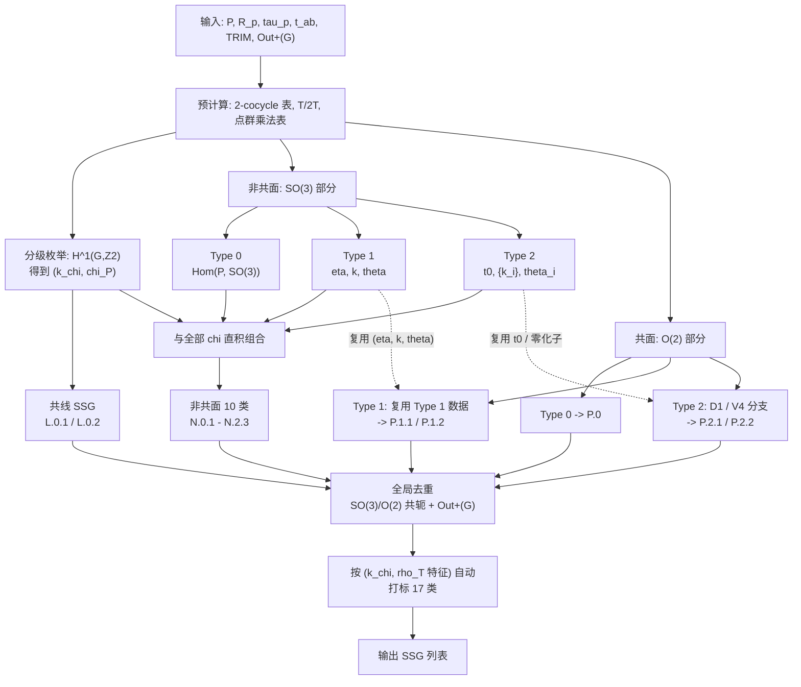

# 自旋空间群枚举算法：完整流程与实现规范

> 本文把补充材料中的群论枚举算法整理为一份可直接编程实现的完整文档（Python / GAP / Mathematica / Julia 均可）。
> 全文分三层：**总体流程**（第 3 节框图与第 4 节自然语言）、**各子模块**（第 5 节，自然语言 + 伪代码）、**工程细节**（第 6–9 节：去重、复用、自动打标、实现要点）。
> 文中记号与补充材料一致；17 类自旋点阵采用 L.0.1–N.2.3 的编号。

---

## 1. 问题、约定与总体思路

### 1.1 目标

给定母空间群 $G$（点群 $P$、平移群 $\mathrm{T}$、分数平移 $\boldsymbol{\tau}_p$），枚举所有不等价的自旋空间群（SSG），即所有不等价的同态

$$
\varrho:\ G\longrightarrow O(3),
$$

并把每个 SSG 归入 17 类自旋点阵类型之一。

### 1.2 三层分解

整个算法建立在三次分解之上。

**第一层：反幺正分级。** $O(3)\cong SO(3)\times\mathbb{Z}_2^{\mathcal{T}}$，故

$$
\varrho(g)=\chi(g)\,\rho(g),\qquad \chi:G\to\{\pm1\},\quad \rho:G\to SO(3).
$$

$\chi$ 是反幺正分级（等价于 type-I/III/IV 磁空间群），$\rho$ 是通常同态。两者**独立枚举后直积**。

**第二层：平移 holonomy。** 把 $\rho$ 限制到平移群，得到 $\rho_T=\rho|_{\mathrm{T}}$。由于 $\mathrm{T}$ 交换，$\rho_T(\mathrm{T})$ 必是 $SO(3)$ 的交换子群。共轭意义下只有三类：

| 类型 | $\rho_T(\mathrm{T})$ | 含义 |
|---|---|---|
| Type 0 | $\{E\}$ | 平移不转动自旋 |
| Type 1 | $\subset SO(2)_{\boldsymbol n}$，非平凡 | 绕固定轴转动，波矢 $\boldsymbol k$ |
| Type 2 | $V_4$ | 三个正交 $\pi$ 转动，三个 TRIM 波矢 |

**第三层：点群部分。** 固定 $\rho_T$ 后，$\rho(s(p))$ 必须落在 $\rho_T(\mathrm{T})$ 的正规化子中；其残余自由度由**协变条件**与**受阻 1-cocycle 方程**决定。这一步是有限（或由连续波矢参数化）的线性代数问题。

### 1.3 为什么按 collinear / coplanar / noncoplanar 组织

三种磁结构对应不同的 spin-only 群：

* **共线**：$\mathcal S=SO(2)_z\rtimes\{E,\mathcal P R_x(\pi)\}$，自旋空间退化到 $O(1)$；
* **共面**：$\mathcal S=\{E,\mathcal P R_z(\pi)\}$，自旋空间为 $O(2)$，且 $\chi_T\equiv1$；
* **非共面**：$\mathcal S$ 平凡，$\rho$ 取 $SO(3)$ 值，$\chi$ 独立。

因此共线与共面是**退化情形**，可复用非共面的代数数据（见第 7 节），不必写三套独立算法。

---

## 2. 输入输出规范

### 2.1 输入

对给定母空间群 $G$：

| 数据 | 说明 |
|---|---|
| $P=\{p_1,\dots,p_{|P|}\}$ | 点群元素，$p_1=E$ |
| $R_p\in GL(3,\mathbb Z)$ | 整矩阵旋转表示 |
| 乘法表 $(p_a,p_b)\mapsto p_c$ | 点群乘法 |
| $\boldsymbol\tau_p\in\mathbb R^3$ | 每个点群元的分数平移 |
| $\boldsymbol t_{a,b}=\boldsymbol\tau_{p_a}+R_{p_a}\boldsymbol\tau_{p_b}-\boldsymbol\tau_{p_ap_b}$ | 系统 2-cocycle，取值于 $\mathbb Z^3$ |
| $\{\boldsymbol b_i\}$ | 倒易基矢；$\widehat L$ 为倒格 |
| $\mathcal K_{\rm TRIM}$ | $\{\tfrac12(n_1\boldsymbol b_1+n_2\boldsymbol b_2+n_3\boldsymbol b_3)\mid n_i\in\{0,1\}\}$ |
| $\mathrm{Out}^+(G)$ | 保手征外自同构的代表元 |

### 2.2 输出

每个 SSG 记为

$$
\mathrm{SSG}=\big\langle \dim,\ \text{type},\ \chi,\ \rho_T,\ \{\rho(s(p))\}_{p\in P}\big\rangle,
$$

其中

* `dim` $\in\{\text{Collinear},\text{Coplanar},\text{Noncoplanar}\}$；
* `type` $\in$ {L.0.1, …, N.2.3}（17 类之一）；
* $\chi$：点群上的符号 $\chi_P(p)\in\{\pm1\}$ 与反幺正波矢 $\boldsymbol k_\chi\in\{0\}\cup\mathcal K_{\rm TRIM}$；
* $\rho_T$：$\boldsymbol k$ 或 $\{\boldsymbol k_1,\boldsymbol k_2,\boldsymbol k_3\}$（连续情形保留为符号参数）；
* $\rho(s(p))$：$O(2)$ 或 $SO(3)$ 中的矩阵。

### 2.3 记号约定

* $\boldsymbol k$ 为自旋调制波矢（不是电子能带动量），取值于 $\mathbb R^3/\widehat L$；
* $\boldsymbol k_\chi$ 为反幺正平移分级的波矢，$\chi_T(\boldsymbol t)=e^{i\boldsymbol k_\chi\cdot\boldsymbol t}$；
* $J_z$ 为绕 $\hat z$ 的转动生成元，$R_x(\pi)=\mathrm{diag}(1,-1,-1)$；
* $D_1=\{E,R_x(\pi)\}\cong\mathbb Z_2$，$V_4=\{E,R_x(\pi),R_y(\pi),R_z(\pi)\}$；
* 所有同态都模去 $SO(3)$ 共轭（共面情形模去 $O(2)$ 共轭），最后再模去 $\mathrm{Out}^+(G)$。

---

## 3. 总体流程

### 3.1 程序框图



> 若查看器不支持 Mermaid，可按下面 3.2 的时序阅读；两者内容相同。

### 3.2 执行时序（文字版）

```
Step 1  预计算：系统 2-cocycle 表 {t_ab}、T/2T ≅ (Z2)^3、点群乘法表、TRIM 集合。
Step 2  解 H^1(G,Z2)：得到全部 (k_chi, chi_P)。
        └─ 直接产出共线 SSG（L.0.1 / L.0.2）。
Step 3  非共面 SO(3) 部分：
        3a  Type 0：Hom(P, SO(3))；
        3b  Type 1：遍历 eta ∈ Hom(P,Z2)，解协变条件与受阻 1-cocycle；
        3c  Type 2：遍历点群不变的 t0 ∈ T/2T，解 S3-扭曲 1-cocycle。
Step 4  把 Step 3 的每个 rho 与 Step 2 的每个 chi 组合，得到非共面全部 10 类。
Step 5  共面 O(2) 部分：
        5a  Type 0：Hom(P,O(2)) → P.0；
        5b  Type 1：复用 3b 的 (eta,k,theta) → P.1.1 / P.1.2；
        5c  Type 2：分支 D1 → P.2.1；分支 V4 → P.2.2。
Step 6  全局去重：先模 SO(3)（非共面）或 O(2)（共面、共线）共轭，再模 Out+(G)。
Step 7  自动打标：按 k_chi 与 rho_T 的特征写入 17 类编号。
```

---

## 4. 主流程：逐步的自然语言说明

### Step 0：预计算

先把 $G$ 的乘法结构全部展开成表：点群乘法表、每个点群元的分数平移 $\boldsymbol\tau_p$，以及由它们得到的 2-cocycle $\boldsymbol t_{a,b}$。同时列出 $\mathrm T/2\mathrm T\cong\mathbb Z_2^3$ 的 8 个元素和全部 TRIM。后续所有模块只读这些表，不再重新推导群结构。这一步是纯数据准备，与具体磁结构无关。

### Step 1：枚举反幺正分级

反幺正分级 $\chi$ 由两部分组成：平移部分的波矢 $\boldsymbol k_\chi$（取 $0$ 或某个 TRIM），以及点群部分的符号 $\chi_P(p)$。并不是任意组合都成立：把 $\chi$ 写成 $\chi(\boldsymbol t\,s(p))=e^{i\boldsymbol k_\chi\cdot\boldsymbol t}\chi_P(p)$ 后，要求它对群乘法保持同态，这会给出两组条件。其一是 $\boldsymbol k_\chi$ 必须在点群作用下不变（模倒格），否则共轭一个平移就会改变 $\chi_T$；其二是 $\chi_P$ 必须满足一个以 $e^{i\boldsymbol k_\chi\cdot\boldsymbol t_{a,b}}$ 为因子的 1-cocycle 方程。后者是模 2 线性方程组，用 GF(2) 高斯消元一次解出。把所有解收集起来，就得到 $H^1(G,\mathbb Z_2)$ 的完整列表。

### Step 2：共线 SSG

共线情形的自旋空间只有一维，$\rho$ 取 $O(1)=\{\pm1\}$ 的值，因此**一个分级就是一个共线 SSG**：$\rho_T(\boldsymbol t)=e^{i\boldsymbol k_\chi\cdot\boldsymbol t}\mathbb 1_3$，$\rho(s(p))=\chi_P(p)\mathbb 1_3$。按 $\boldsymbol k_\chi=0$ 或 $\neq0$ 分别标记为 L.0.1 与 L.0.2。这一步不需要任何额外枚举，直接复用 Step 1 的结果。

### Step 3a：非共面 Type 0

Type 0 的平移 holonomy 是平凡的，$\rho$ 完全由点群决定，即求 $\mathrm{Hom}(P,SO(3))$。做法是：先取 $P$ 的一个正规子群 $H$ 作为核，商群 $P/H$ 必须抽象同构于 $SO(3)$ 的有限子群（$C_n,D_n,T,O,I$）；对每个这样的子群，枚举同构 $P/H\to S$，再沿商映射拉回成 $P$ 上的同态。不同的 $H$ 与不同的（共轭类）$S$ 给出不同的同态。最后模去 $SO(3)$ 共轭。

### Step 3b：非共面 Type 1

Type 1 的平移部分绕固定轴转动，写作 $\rho_T(\boldsymbol t)=e^{-i(\boldsymbol k\cdot\boldsymbol t)J_z}$，由波矢 $\boldsymbol k$ 标记。点群部分写成

$$
\rho(s(p))=e^{-i\theta(s(p))J_z}\,[R_x(\pi)]^{(1-\eta_p)/2},
$$

其中 $\eta:P\to\{\pm1\}$ 是 $\mathbb Z_2$ 同态，表示 $p$ 是否翻转转轴。枚举分四小步：先遍历所有 $\eta$；再对每个 $\eta$ 解**协变条件** $R_p\boldsymbol k=\eta_p\boldsymbol k\pmod{\widehat L}$，得到离散的高对称点与连续的线/面；然后对每个 $\boldsymbol k$ 检查**受阻 1-cocycle** 的障碍 $[\nu_{\boldsymbol k}]=1$（否则无解）；最后解齐次方程，得到 $\theta$ 的解空间并构造 $\rho$。连续波矢保留为参数，不离散化。

### Step 3c：非共面 Type 2

Type 2 的平移部分 $\rho_T(\mathrm T)\cong V_4$，由三个非零 TRIM 标记。关键是把“核”参数化：$\ker\rho_T=\langle 2\mathrm T,\boldsymbol t_0\rangle$，其中 $\boldsymbol t_0\in\mathrm T/2\mathrm T$ 非零且必须在点群作用下不变（模 $2L$）。三个波矢 $\boldsymbol k_i$ 就是 $\boldsymbol t_0$ 在 TRIM 群中的三个非零零化元素。固定 $\boldsymbol t_0$ 后，点群部分写成 $\rho(s(p))=D(s(p))S(p)$，$S(p)\in S_3$ 由 $\boldsymbol k_i$ 的置换决定，$D$ 的对角角 $\theta_i\in\{0,\pi\}$ 由扭曲 1-cocycle 方程（连同 $\det D=1$）解出。这是模 2 线性方程组。

### Step 4：与非共面分级组合

非共面情形下 $\chi$ 与 $\rho$ 完全独立，所以把 Step 3 得到的每个 $\rho$ 与 Step 2 得到的每个分级 $\chi$ 直接相乘，就得到全部非共面 SSG。组合后按 $(\boldsymbol k,\boldsymbol k_\chi)$ 的关系再细分为 N.0.1–N.2.3。

### Step 5：共面 SSG

共面情形自旋在 $xy$ 平面内，结构群是 $O(2)$，嵌入 $SO(3)$ 的方式固定为 $M\mapsto\mathrm{diag}(M,\det M)$。由于所有平移都是幺正的，$\chi_T\equiv1$，因此没有独立的分级需要枚举。Type 0 是 $\mathrm{Hom}(P,O(2))$，等价于对每个 $\eta$ 解一维共表示；Type 1 与“$\chi_T=1$ 的非共面 Type 1”逐式相同，直接复用其 $(\eta,\boldsymbol k,\theta)$ 数据，只需换用 $O(2)$ 矩阵；Type 2 分两支：$\rho_T\cong D_1$（一个波矢为零）给出 P.2.1，$\rho_T\cong V_4$（两个非零 TRIM）给出 P.2.2。

### Step 6：全局去重

先消除自旋空间的共轭等价：非共面用 $SO(3)$ 共轭（会同时作用在 $\rho_T$ 与 $\rho(s(p))$ 上），共面与共线用 $O(2)$/$O(1)$ 共轭。再消除空间群的自同构等价：对每个 $\alpha\in\mathrm{Out}^+(G)$，把 SSG 变换一次，若变换结果与列表中另一项自旋共轭等价，就把两者合并。注意只保留保手征的自同构。

### Step 7：自动打标

对每个去重后的 SSG，按 $\chi_T$ 是否为 $1$、$\rho_T$ 的图像类型、以及 $(\boldsymbol k,\boldsymbol k_\chi)$ 的关系，查表写入 17 类编号（见第 8 节）。这一步不产生新群，只是命名。

---

## 5. 子模块：自然语言 + 伪代码

### 5.1 模块 1：反幺正分级 $H^1(G,\mathbb Z_2)$

**做什么。** 枚举所有同态 $\chi:G\to\mathbb Z_2$。由于 $\mathbb Z_2$ 交换，$\chi$ 完全由它在平移上的值（即 $\boldsymbol k_\chi$）和它在点群代表元上的符号 $\chi_P$ 决定。

**怎么做。** 对每个候选 $\boldsymbol k_\chi$（$0$ 与全部 TRIM）：先检查点群不变性；再把同态条件化成模 2 线性方程组并求解；每个解给出一个分级。

```text
Algorithm: Enumerate_Gradings(G)
Input:  G = (P, T, {tau_p}, {t_ab})
Output: List of (k_chi, chi_P)

1. Gradings <- empty
2. For each k_chi in {0} ∪ K_TRIM:
3.     // (a) 点群不变性: 否则共轭平移会破坏 chi_T
4.     If exists p in P with R_p k_chi != k_chi (mod L_hat): continue
5.     // (b) 1-cocycle 方程 chi_P(a) chi_P(b) = exp(i k_chi·t_ab) chi_P(a b)
6.     //     令 chi_P(p) = (-1)^{x_p}，化为 GF(2) 线性方程组
7.     M, b <- Build_GF2_System(P, k_chi, t)
8.     For each solution x of M x = b (mod 2):
9.         chi_P <- [(-1)^{x_p} for p in P]
10.        Gradings.append((k_chi, chi_P))
11. Return Gradings
```

### 5.2 模块 2：非共面 Type 0

**做什么。** 求 $\mathrm{Hom}(P,SO(3))$。

**怎么做。** 任一 homomorphism 由它的核 $H\triangleleft P$ 与像 $S\subset SO(3)$ 决定，$P/H\cong S$。因此枚举所有正规子群 $H$、所有与 $P/H$ 同构的 $SO(3)$ 有限子群 $S$、以及 $P/H\to S$ 的同构；再模去 $SO(3)$ 共轭。

> **关于共轭的注记。** 两个同构 $\phi,\phi':Q\to S$ 给出的同态在 $SO(3)$ 中共轭，当且仅当存在 $R\in N_{SO(3)}(S)$ 使 $\phi'=\mathrm{Ad}_R\circ\phi$；等价类由 $N_{SO(3)}(S)/C_{SO(3)}(S)$ 在 $\mathrm{Iso}(Q,S)$ 上的作用给出。对本文会出现的全部像 $S$（晶体学的 $C_1,C_2,C_3,C_4,C_6$、$D_1$–$D_4,D_6$、$T$、$O$），该群恰好等于 $\mathrm{Aut}(S)$，作用传递，因此 $Q\to S$ 的全部同构彼此共轭，每个 $(H,[S])$ 只给出一个 spin point group：
>
> | $S$ | $|\mathrm{Aut}(S)|$ | $|N_{SO(3)}(S)/C_{SO(3)}(S)|$ |
> |---|---|---|
> | $C_1$ | 1 | 1 |
> | $C_2\,(D_1)$ | 1 | 1 |
> | $C_3,\,C_4,\,C_6$ | 2 | 2 |
> | $V_4\,(D_2)$ | 6 | 6 |
> | $D_3$ | 6 | 6 |
> | $D_4$ | 8 | 8 |
> | $D_6$ | 12 | 12 |
> | $T$ | 24 | 24 |
> | $O$ | 24 | 24 |
> | $C_5$（非晶体学） | 4 | 2 |
> | $I$（非晶体学） | 120 | 60 |
>
> 最后两行说明"全部同构共轭等价"并非对任意有限子群都成立（$C_5$ 有 $\mathrm{Aut}=\mathbb Z_4$ 而 $N/C=\mathbb Z_2$，$I=A_5$ 有 $\mathrm{Aut}=S_5$ 而 $N/C=A_5$）；但空间群的像只可能是前九行，故 Litvin 方法中"每个 $(H,[S])$ 取一个代表"是正确的。

```text
Algorithm: Enumerate_Noncoplanar_Type0(G)
Input:  P
Output: List of homomorphisms rho_P: P -> SO(3)

1. Out <- empty
2. For each normal subgroup H of P:
3.     Q <- P / H
4.     If Q is not isomorphic to a finite subgroup of SO(3): continue
5.     For each conjugacy class of subgroups S ⊂ SO(3) with S ≅ Q:
6.         Choose one iso phi: Q -> S        // 晶体学像：所有同构共轭等价
7.         rho_P(p) <- phi(p H)              // 沿商映射拉回
8.         Out.append(rho_P)
9. Return Out                              // 全局去重见第 6 节
```

### 5.3 模块 3：非共面 Type 1

**做什么。** 平移绕固定轴转动；枚举 $(\eta,\boldsymbol k,\theta)$。

**怎么做。** 三件事：遍历 $\eta$；解协变条件得到允许的 $\boldsymbol k$；解受阻 1-cocycle 得到 $\theta$。其中 $\boldsymbol k$ 可能是离散点，也可能是线/面上的连续族，程序里用符号参数表示。

```text
Algorithm: Enumerate_Noncoplanar_Type1(G)
Input:  G
Output: List of records (eta, k, theta)

1. Out <- empty
2. For each eta in Hom(P, Z2):
3.     // (a) 协变条件 R_p k = eta_p k (mod L_hat)
4.     K_candidates <- Solve_Covariant_Wavevectors(P, eta)
5.     //     离散高对称点 + 连续线/面的参数方程
6.     For each k in K_candidates:
7.         // (b) 受阻 1-cocycle:
8.         //     theta_a + eta_a theta_b - theta_c = k·t_ab (mod 2pi)
9.         Solvable, theta0 <- Solve_Obstructed_1_Cocycle(P, eta, k, t)
10.        If not Solvable: continue
11.        // (c) 齐次解 H^{1,eta}(P,U(1))
12.        Hom <- Solve_H1_eta(P, eta)
13.        For each h in Hom:
14.            theta <- theta0 + h
15.            Out.append((eta, k, theta))
16. Return Deduplicate_k_to_minus_k(Out)   // (k,theta) ~ (-k,-theta)
```

**受阻 1-cocycle 的数值解法（Smith 标准型）。** 把 $|P|^2$ 个方程写成整矩阵形式 $M\boldsymbol\theta=\boldsymbol V+2\pi\boldsymbol m$；对 $M$ 做 Smith 分解 $UMV=D$；检查 $U\boldsymbol V$ 在 $D$ 的零对角行上是否为 $2\pi$ 的整数倍——是则有解并可直接读出特解，否则障碍非平凡。齐次解由 $D$ 的非零对角元给出（对应有限循环群 $\bigoplus_i\mathbb Z_{d_i}$）。

### 5.4 模块 4：非共面 Type 2

**做什么。** 平移 holonomy 为 $V_4$；枚举 $(\boldsymbol t_0,\{\boldsymbol k_i\},\theta_i)$。

**怎么做。** 先用 $\boldsymbol t_0$ 参数化核；由零化子得到三个 TRIM；由点群作用得到 $S_3$ 置换；最后解 $\theta_i\in\{0,\pi\}$ 的模 2 方程组。

```text
Algorithm: Enumerate_Noncoplanar_Type2(G)
Input:  G
Output: List of records (t0, {k_i}, theta)

1. Out <- empty
2. For each nonzero t0 in T/2T:
3.     If not (R_p t0 = t0 (mod 2L) for all p in P): continue
4.     // (a) 零化子: k_i·t0 = 0 (mod 2pi) 的三个非零 TRIM
5.     (k1,k2,k3) <- Compute_Annihilator_TRIMs(t0)
6.     // (b) 置换 sigma: R_p k_i = k_{sigma_p(i)} (mod L_hat)
7.     sigma <- Compute_Permutation(P, (k1,k2,k3))
8.     If sigma is None: continue
9.     // (c) 扭曲 1-cocycle, 变量 theta_{p,i} ∈ {0,pi}
10.    //     det D = 1: theta_{p,1}+theta_{p,2}+theta_{p,3} = 0 (mod 2pi)
11.    //     theta_{a,i}+theta_{b,sigma_a^{-1}(i)}-theta_{ab,i} = k_i·t_ab (mod 2pi)
12.    For each solution theta:
13.        rho_T(t)  <- diag((-1)^{k1·t/pi}, (-1)^{k2·t/pi}, (-1)^{k3·t/pi})
14.        rho_P(p)  <- D(s(p)) S(p)
15.        Out.append((t0, (k1,k2,k3), theta))
16. Return Deduplicate_SpinConjugation(Out)
```

### 5.5 模块 5：共面 Type 0

**做什么。** 求 $\mathrm{Hom}(P,O(2))$。

**怎么做。** 写 $\rho_P(p)=C(p)\sigma^{(1-\eta_p)/2}$，$C(p)\in SO(2)$，$\eta\in\mathrm{Hom}(P,\mathbb Z_2)$。对每个 $\eta$，$C$ 的相位 $\theta$ 满足齐次 1-cocycle 方程，其解空间为 $H^{1,\eta}(P,U(1))$。

```text
Algorithm: Enumerate_Coplanar_Type0(G)
Input:  G
Output: List of P.0 SSGs

1. Out <- empty
2. For each eta in Hom(P, Z2):
3.     For each theta in Solve_H1_eta(P, eta):
4.         For p in P:
5.             M2 <- Rotation_2D(theta_p) * diag(1,-1)^{(1-eta_p)/2}
6.             rho_P(p) <- Embed_O2_to_SO3(M2)     // diag(M2, det M2)
7.         Out.append(SSG(dim=Coplanar, type=P.0, rho_T=1, rho_P))
8. Return Out
```

### 5.6 模块 6：共面 Type 1

**做什么。** 平面螺旋与交错共面。

**怎么做。** 与“$\chi_T=1$ 的非共面 Type 1”逐式相同，直接复用模块 3 的记录；唯一区别是矩阵取 $O(2)$ 形式并嵌入 $SO(3)$。

```text
Algorithm: Enumerate_Coplanar_Type1(G, Cached_Type1)
Input:  Cached_Type1 = 模块 3 的全部 (eta, k, theta)
Output: List of P.1.1 / P.1.2 SSGs

1. Out <- empty
2. For each (eta, k, theta) in Cached_Type1:
3.     For p in P:
4.         M2 <- Rotation_2D(theta_p) * diag(1,-1)^{(1-eta_p)/2}
5.         rho_P(p) <- Embed_O2_to_SO3(M2)
6.     rho_T(t) <- Embed_O2_to_SO3(Rotation_2D(k·t))
7.     type <- (k in TRIM) ? P.1.1 : P.1.2
8.     Out.append(SSG(dim=Coplanar, type, rho_T, rho_P))
9. Return Out
```

### 5.7 模块 7：共面 Type 2

**做什么。** $\rho_T\cong D_1$ 或 $V_4$。

**怎么做。** 分两支。**分支 A（$D_1$）**：一个面内分量未调制，另一个由非零 TRIM $\boldsymbol k_2$ 调制；按本文约定取 $k_1=0$、$k_2\in$TRIM。**分支 B（$V_4$）**：两个分量分别由两个不同非零 TRIM 调制；点群部分还带一个交换 $x\leftrightarrow y$ 的置换 $R$。

```text
Algorithm: Enumerate_Coplanar_Type2(G)
Input:  G
Output: List of P.2.1 / P.2.2 SSGs

1. Out <- empty

2. // ---------- 分支 A: D1 -> P.2.1 ----------
3. // D1 = {E, sigma}: rho_T 由一个非零 TRIM k2 完全决定 (约定 k1 = 0)
4. For each nonzero TRIM k2 with R_p k2 = k2 (mod L_hat) for all p in P:
5.     // 普通 1-cocycle: theta_i(a)+theta_i(b)-theta_i(ab) = k_i·t_ab (mod 2pi)
6.     // i = 1 (k1 = 0) 与 i = 2 (k2); 解 GF(2) 线性系统
7.     Solutions <- Solve_Cocycle_D1(P, 0, k2, t)
8.     For each (theta1, theta2) in Solutions:
9.         rho_T(t) <- Embed_O2_to_SO3(diag(1, (-1)^{k2·t/pi}))
10.        rho_P(p) <- D(s(p))
11.        Out.append(SSG(dim=Coplanar, type=P.2.1, k1=0, k2, rho_T, rho_P))

12. // ---------- 分支 B: V4 -> P.2.2 ----------
13. For each nonzero t0 in T/2T invariant under P (mod 2L):
14.     (k1,k2) <- 零化子中的两个非零 TRIM (互不相同)
15.     // 置换 sigma ∈ S2: R_p k_i = k_{sigma_p(i)}
16.     sigma <- Compute_S2_Permutation(P, k1, k2)
17.     If sigma is None: continue
18.     // 扭曲 1-cocycle, theta_{p,i} ∈ {0,pi}, i=1,2
19.     // theta_{a,i}+theta_{b,sigma_a^{-1}(i)}-theta_{ab,i} = k_i·t_ab (mod 2pi)
20.     For each solution theta:
21.         D(s(p)) <- diag(e^{i theta_{p,1}}, e^{i theta_{p,2}})
22.         S(p)    <- Permutation_2x2(sigma_p)      // 单位阵或 [[0,1],[1,0]]
23.         rho_T(t) <- Embed_O2_to_SO3(diag((-1)^{k1·t/pi}, (-1)^{k2·t/pi}))
24.         rho_P(p) <- Embed_O2_to_SO3(D(s(p)) S(p))
25.         Out.append(SSG(dim=Coplanar, type=P.2.2, k1, k2, rho_T, rho_P))

26. Return Deduplicate_SpinConjugation(Out)
```

### 5.8 主程序的伪代码

```text
Algorithm: Enumerate_SSG(G)
Input:  Space group G = (P, T, tau, t_ab)
Output: Set of inequivalent SSGs with 17-type labels

 1. Gradings <- Enumerate_Gradings(G)
 2. All <- empty
 3. // 共线
 4. All += Build_Collinear_SSGs(Gradings)
 5. // 非共面 SO(3) 部分
 6. R <- Enumerate_Noncoplanar_Type0(G)
 7.    + Enumerate_Noncoplanar_Type1(G)
 8.    + Enumerate_Noncoplanar_Type2(G)
 9. For each rho in R:
10.     For each chi in Gradings:
11.         All.append(Combine(rho, chi))
12. // 共面 O(2) 部分
13. All += Enumerate_Coplanar_Type0(G)
14. All += Enumerate_Coplanar_Type1(Cached_Type1)
15. All += Enumerate_Coplanar_Type2(G)
16. // 去重与打标
17. All <- Deduplicate_SpinConjugation(All)
18. All <- Deduplicate_Automorphism(All, Out_plus_G)
19. For s in All: s.type <- Label_17(s)
20. Return All
```

---

## 6. 等价性去重

### 6.1 自旋共轭

两个 SSG 若相差一个整体自旋旋转，则等价：$\varrho_1(g)=R\,\varrho_2(g)R^{-1}$，$R\in SO(3)$（共面时 $R$ 取 $O(2)$ 中元素，共线时取 $O(1)$）。实现上，对每个 $\rho_T$ 先把像共轭到标准形（Type 1 转到 $\hat z$；Type 2 转到标准 $V_4$），再比较点群矩阵。Type 1 的 $(\boldsymbol k,\theta)\sim(-\boldsymbol k,-\theta)$ 就属于这一类（$R=R_x(\pi)$）。

### 6.2 空间群自同构

两个 SSG 若相差一个保手征外自同构 $\alpha\in\mathrm{Out}^+(G)$，则描述的是同一类磁结构的不同坐标选取。实现：对每个 $\alpha$，把 SSG 的每个元素 $g$ 换成 $\alpha(g)$，重新计算 $\varrho$，再与列表中的项做 6.1 的共轭比较；命中则合并。

### 6.3 去重顺序

先 6.1 后 6.2。因为 6.2 的轨道比较本身要用 6.1 的判据；若反过来，会把“自旋共轭但不满足自同构”的项误判为不同。

---

## 7. 跨维度数据复用

三种磁结构共享同一批代数对象，主程序只算一次：

```
                 [ G 的底层数据: P, R_p, tau_p, t_ab, TRIM ]
                    /                         \
                   v                           v
        [ H^1(G,Z2) 分级表 ]          [ Hom(P,Z2) 与协变波矢 W_eta ]
                   |                           |
                   v                           v
            [ 共线 SSG ]              [ Type 1 数据 (eta,k,theta) ]
                   |                     /              \
                   |                    v                v
                   |          [ 共面 Type 1 ]   [ 非共面 Type 1 ]
                   |
                   v
        [ 与分级直积 -> 非共面 N.0.1-N.2.3 ]

        [ 不变 t0 搜索 ] ---> V4 分支共用 (P.2.2 / N.2.x)
        [ 非零 TRIM 列表 ] ---> D1 分支 (P.2.1)
```

三条复用关系：

1. **分级复用**：$H^1(G,\mathbb Z_2)$ 既直接给出全部共线 SSG，又作为 $\chi$ 供非共面组合。
2. **Type 1 复用**：共面 Type 1 与“$\chi_T=1$ 的非共面 Type 1”逐式相同；$(\eta,\mathcal W_\eta,[\nu_{\boldsymbol k}],H^{1,\eta})$ 只算一次。
3. **Type 2 复用**：$V_4$ 分支（P.2.2 与 N.2.1–N.2.3）的 $\boldsymbol t_0$ 不变性搜索与零化子三元组完全相同，只是后续置换群取 $S_2$ 或 $S_3$；$D_1$ 分支（P.2.1）不需要 $\boldsymbol t_0$，只需遍历被 $P$ 固定的非零 TRIM $\boldsymbol k_2$。

---

## 8. 17 类自动打标

去重后，按下面的判定表写入类型编号（只读 $\chi_T$、$\rho_T$ 与 $(\boldsymbol k,\boldsymbol k_\chi)$）：

| 维度 | 判据 | 类型 |
|---|---|---|
| Collinear | $\boldsymbol k_\chi=0$ | L.0.1 |
| Collinear | $\boldsymbol k_\chi\neq0$ | L.0.2 |
| Coplanar | $\rho_T\equiv1$ | P.0 |
| Coplanar | $\rho_T\subset SO(2)$，$\boldsymbol k\in$TRIM | P.1.1 |
| Coplanar | $\rho_T\subset SO(2)$，$\boldsymbol k$ general | P.1.2 |
| Coplanar | $\rho_T\cong D_1$ | P.2.1 |
| Coplanar | $\rho_T\cong V_4$ | P.2.2 |
| Noncoplanar | $\rho_T\equiv1$，$\boldsymbol k_\chi=0$ | N.0.1 |
| Noncoplanar | $\rho_T\equiv1$，$\boldsymbol k_\chi\neq0$ | N.0.2 |
| Noncoplanar | Type 1，$\boldsymbol k_\chi=0$，$\boldsymbol k\in$TRIM | N.1.1 |
| Noncoplanar | Type 1，$\boldsymbol k_\chi=0$，$\boldsymbol k$ general | N.1.2 |
| Noncoplanar | Type 1，$\boldsymbol k_\chi=\boldsymbol k\in$TRIM | N.1.3 |
| Noncoplanar | Type 1，$\boldsymbol k\in$TRIM，$\boldsymbol k_\chi\notin\{0,\boldsymbol k\}$ | N.1.4 |
| Noncoplanar | Type 1，$\boldsymbol k_\chi\neq0$，$\boldsymbol k$ general | N.1.5 |
| Noncoplanar | Type 2，$\boldsymbol k_\chi=0$ | N.2.1 |
| Noncoplanar | Type 2，$\boldsymbol k_\chi\in\{\boldsymbol k_i\}$ | N.2.2 |
| Noncoplanar | Type 2，$\boldsymbol k_\chi\notin\{0,\boldsymbol k_i\}$ | N.2.3 |

实现时建议把这张表写成对 $(\text{dim},\ \text{isTRIM}(\boldsymbol k),\ \boldsymbol k_\chi,\ \text{image type})$ 的嵌套分支，而不是逐条 if-else。

---

## 9. 实现要点、复杂度与验证

### 9.1 实现要点

1. **模 2 线性代数**：分级方程与 Type 2 的 $D$ 方程都是 GF(2) 线性系统，用 bitset 高斯消元即可；|P|≤48，单群在毫秒量级。
2. **符号波矢**：连续族（P.1.2、N.1.2、N.1.5 等）不要离散化；把 $\boldsymbol k$ 写成受对称性约束的参数形式（如四方情形 $(0,0,k_z)$），方程里的 $\boldsymbol k\cdot\boldsymbol t$ 保留为符号表达式。
3. **连续性判定**：程序需要区分“离散高对称点”与“线/面”，建议在解协变条件时同时返回参数维数。
4. **浮点/精确算术**：$\theta$ 只取 $0,\pi$（Type 2）或 $2\pi$ 的有理倍（Type 1 的有限解），尽量用整数/有理数算术；连续参数单独处理。

### 9.2 复杂度

* 分级：$8\times$ GF(2) 解方程，$O(|P|^3)$ 每条。
* Type 0：正规子群枚举（$|P|\le48$，可预先列表）+ 小群同构判定。
* Type 1：$|\mathrm{Hom}(P,\mathbb Z_2)|\le 2^{r}$ 个 $\eta$，每个解一次协变条件与一次 SNF。
* Type 2：7 个 $\boldsymbol t_0$ 类，每个解一次 GF(2) 系统。
* 去重：$O(N^2)$ 比较；若 $N$ 大，可用 $\rho_T$ 的标准形做哈希分桶。

### 9.3 验证建议

1. **同态自检**：对每个输出的 $\rho$，随机取 $g_1,g_2\in G$，数值验证 $\rho(g_1)\rho(g_2)=\rho(g_1g_2)$。
2. **小群对照**：$P=1$（$G$ 为纯平移）时，Type 0 只有平凡解，Type 1 应给出以 $\boldsymbol k$ 为参数的连续族；检查程序返回的是参数族而不是有限列表。
3. **交叉验证**：对 $|P|\le8$ 的空间群，用暴力枚举 $P\to SO(3)$ 的同态与主程序结果比对（数量与标准形都应一致）。
4. **类型计数**：固定若干母群，检查输出中 17 类的分布与补充材料表格一致；特别检查 P.2.1 的约定（$\boldsymbol k_1=0$、$\boldsymbol k_2\in$TRIM）与 N.2.2/N.2.3 的 $\boldsymbol k_\chi$ 归属。
5. **去重自检**：随机选取一个输出，施加 $\mathrm{Out}^+(G)$ 与自旋共轭，确认它被合并回同一项。

---

## 附录：与补充材料章节的对应

| 本文模块 | 补充材料 |
|---|---|
| §5.1 分级 | §2 反幺正分级与平移 holonomy |
| §5.2 Type 0 | §2 Type 0 |
| §5.3 Type 1 | §2 Type 1（协变条件、受阻 1-cocycle） |
| §5.4 Type 2 | §2 Type 2 |
| §5.5–5.7 共面 | §3.1 共面 SSG |
| §5.8 共线 | §3.2 共线 SSG |
| §8 打标 | §5 17 类自旋点阵 |
